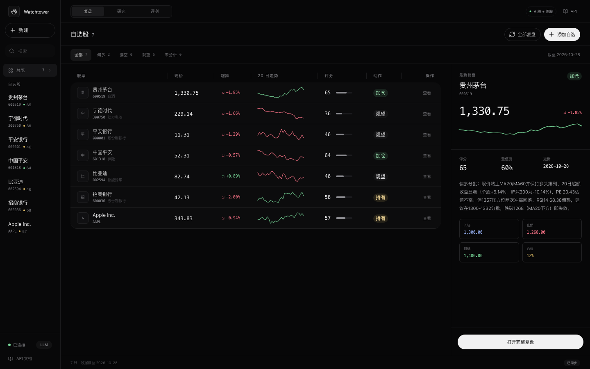
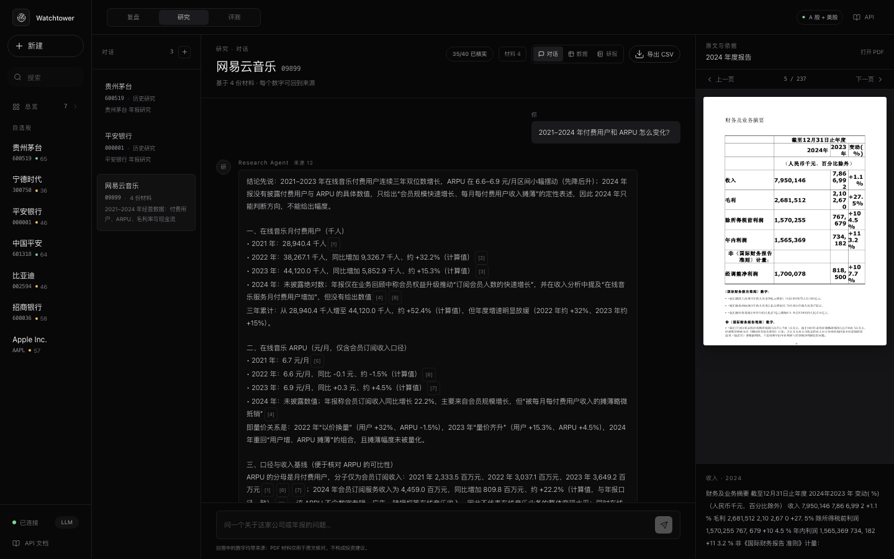
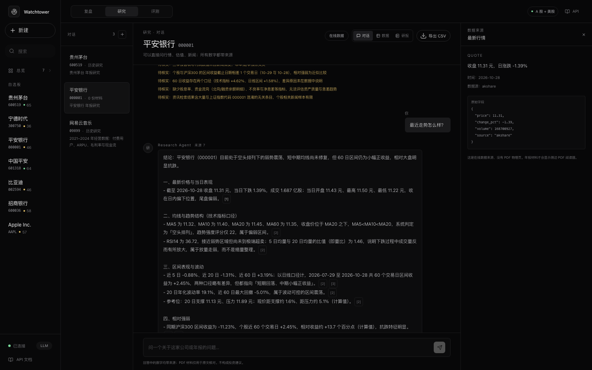
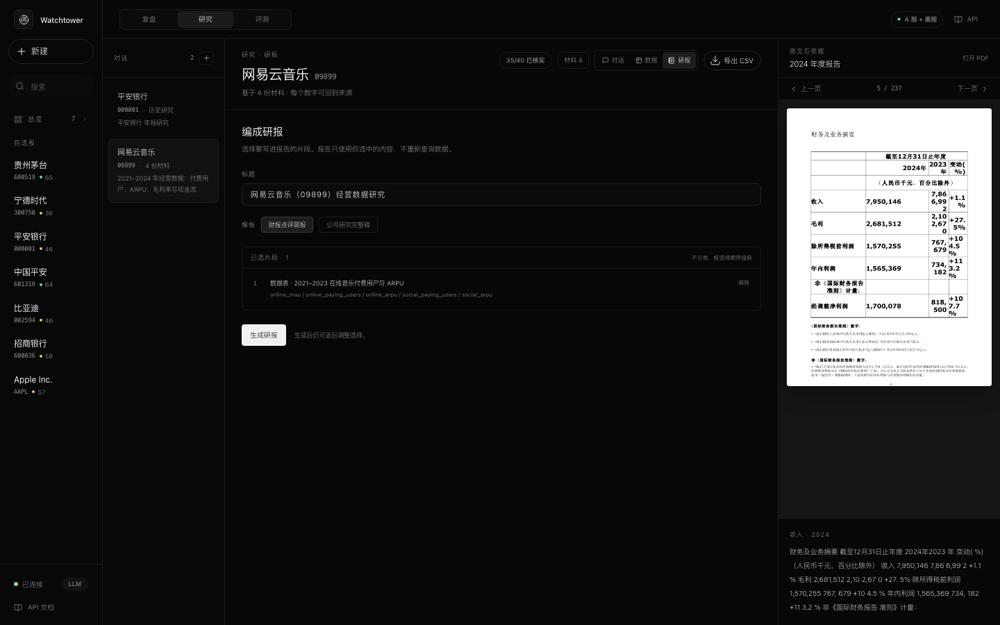
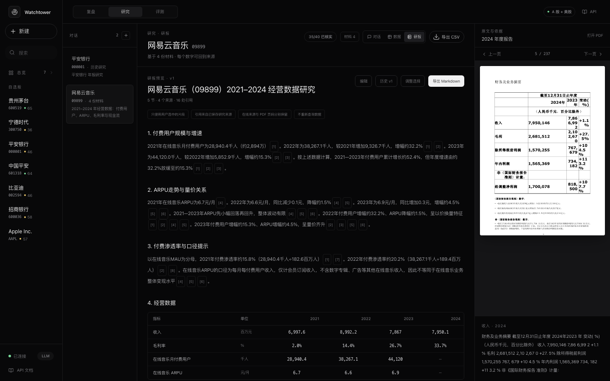
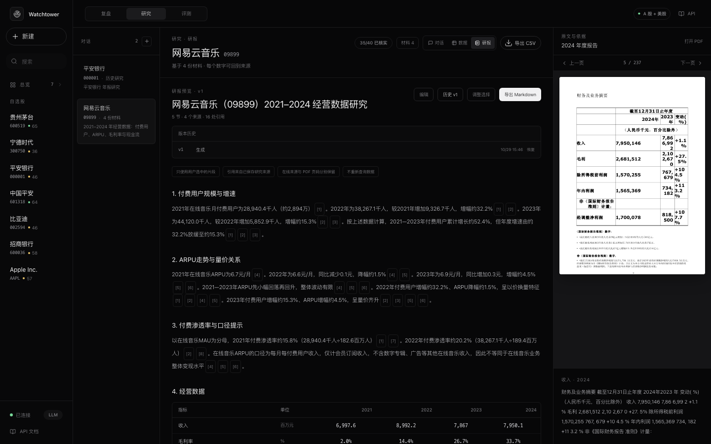
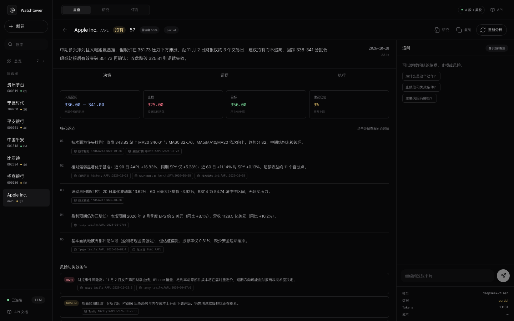
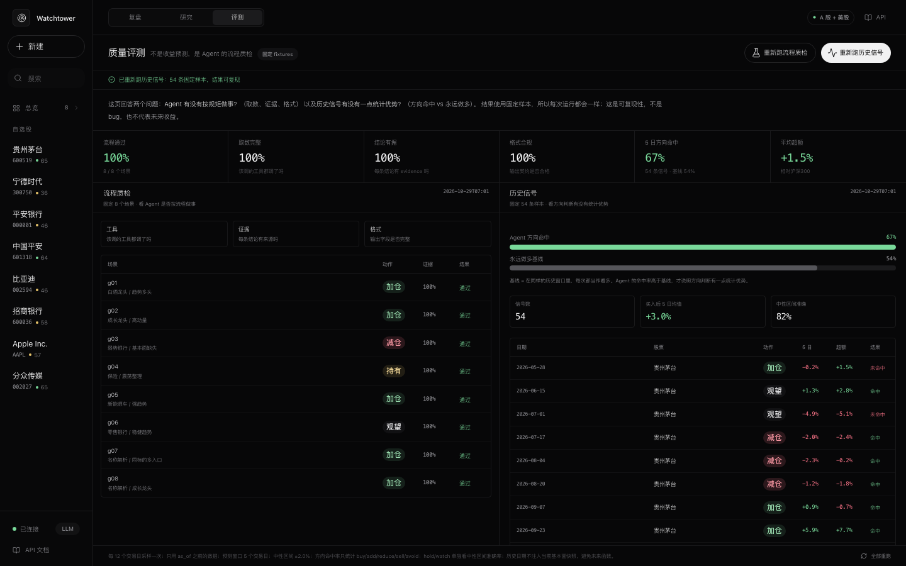
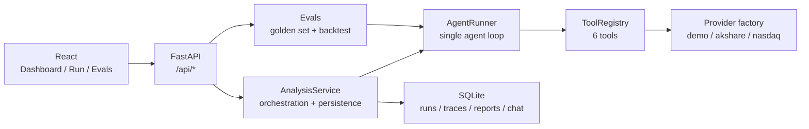

<div align="center">

# Watchtower

**一个带证据链和回测的自选股复盘 Agent**

不是让大模型写一段股评，而是把“抓数据 → 调工具 → 生成决策卡 → 追溯证据 → 回测验证”做成一个能跑、能看、能评的小系统。

[](https://www.python.org/)
[](https://fastapi.tiangolo.com/)
[](https://react.dev/)
[](#测试)
[](LICENSE)

[快速开始](#90-秒跑起来) · [架构](docs/architecture.md) · [API Docs](http://127.0.0.1:8000/docs)

</div>

---

## 为什么不是“又一个股票 GPT”

大多数股票 Agent demo 的问题是：看起来会分析，但无法回答三个问题——

1. **它到底查了什么数据？**
2. **每一句结论对应哪条证据？**
3. **它比“直接问 GPT”好在哪里？**

Watchtower 用三个工程约束回答：

- **工具化**：Agent 只能通过 6 个受控工具获取行情、指标、资讯、基本面和基准，不允许凭空编数字。
- **证据绑定**：每个论点必须带 `evidence_ids`，UI 可以点开看原始 payload；没有证据的结论会被校验器标记或删除。
- **可评测**：8 条 golden set 检查工具选择/Schema/证据覆盖；54 条历史信号做 point-in-time 回测，并和“永远做多”基线对比。

---

## 产品预览

### 工作台：自选股 + 最近一次决策卡



### 研究：四份年报 → 逐年指标 + PDF 物理页


### 研究对话：指标卡 + 页码引用 + PDF 原文



### 没有年报：在线数据 + 来源面板



### 研报：选中片段 → 组装 → 编辑/版本 → 导出







### 决策卡：结论、交易计划、证据链、Agent Trace、追问



### 评测台：golden set + 历史回测



---

## 核心能力

| 能力 | 实现 |
|---|---|
| 自选股工作台 | 左侧自选股 + 主区列表 + 右侧预览；添加/删除、筛选、全部复盘 |
| 单 Agent 工具调用 | 原生 OpenAI-compatible function calling，最多 8 步，失败自动降级 |
| 6 个数据工具 | 行情、日线、技术指标、新闻、基本面、基准指数 |
| 结构化决策卡 | 动作、评分、置信度、论点、风险、入场/止损/目标/仓位 |
| 证据链 | 每条论点绑定 `evidence_ids`，前端可点开原始数据抽屉 |
| 校验器 | 评分/动作一致性、价格计划合理性、证据存在性、日期检查 |
| Agent Trace | 每一步工具、参数、耗时、返回摘要、证据 id 可回放 |
| 追问 | 基于当前报告的多轮问答，不重复抓数据 |
| Golden Set | 8 条固定用例，检查 required tools、Schema、证据覆盖、动作 |
| 历史回测 | 54 条 point-in-time 信号，5 日方向、超额、基线对比 |
| 两种运行模式 | 无 Key 的离线 Demo / 有 Key 的 LLM Agent |
| 真实数据 | A 股 AKShare、美股 Nasdaq / yfinance、Tavily 新闻（可选） |
| 界面 | React 19 + HeroUI v3 + Tailwind v4，单屏工作台、决策卡、评测台 |
| 部署 | 本地、Docker、GitHub Actions 每日任务 |

---

## 界面结构

- **左侧**：品牌、新建复盘、搜索、自选股列表、连接状态。
- **主区**：自选股表（现价、涨跌、20 日走势、评分、动作、操作），支持筛选和全部复盘。
- **右侧预览**：选中股票的最新结论、计划、评分和“打开完整复盘”。
- **决策卡**：顶部只保留股票、动作、评分、置信度；正文用「决策 / 证据 / 执行」三个 Tab，右侧常驻追问，避免长页面滚动。
- **评测台**：顶部指标条 + 左右双栏（Golden Set / 历史回测），表格内部滚动。

## 完整手册

项目架构、数据链路、Agent、研究、研报与评测完整说明：

- [项目完整手册](docs/project-handbook.md)

---

## 本地启动：双击 Watchtower.command（推荐）

不要再用 Safari 的“添加到 Dock”网页快捷方式：它只打开 URL，不会启动后端；后端没起来就会打不开。

最稳的方式是双击：

```text
demo/Watchtower.command
```

它会：

1. 启动本地服务 `127.0.0.1:8765`
2. 轮询 `/api/health`，等服务真正可用
3. 在 Chrome 中打开 `127.0.0.1:8765`
4. 日志写到 `data/logs/server.log`

可以把 `demo/Watchtower.command` 拖到 Dock。  
点击后会短暂打开 Terminal；启动完成后可以最小化 Terminal，演示时只保留 Chrome 窗口。

也可以终端执行：

```bash
./scripts/start_demo.sh
```

停止服务：

```bash
./scripts/stop_demo.sh
```

### 用 Safari

服务启动后，Safari 直接打开：

```text
http://127.0.0.1:8765
```

或者双击：

```text
demo/Watchtower Safari.command
```

它会启动服务并打开 Safari。

Safari 的“添加到 Dock”仍然只是网页快捷方式，**不会启动后端**；如果要用 Safari 的 Dock 图标，先通过 `.command` 启动服务，或让服务在登录时自动启动。

### 可选：App 图标

`demo/Watchtower.app` 是可选版本：它本身只负责打开 Terminal 并执行 `.command`，不直接读取项目文件。  
如果 macOS 仍然拦截，直接用 `.command` 更稳：

- `.command` 由 Terminal 启动，项目目录权限最稳定
- App 只作为 Dock 入口，最终仍走同一条 `.command` 路径

项目移动位置后，重新生成 App：

```bash
./scripts/build_demo_app.sh
```

启动器不依赖当前 shell 的 `PATH`，会先确认 `/api/health` 成功，再打开浏览器；不会再出现“页面打开了但后端没启动”的情况。

---

## 90 秒跑起来

### 方式一：本地开发

```bash
# 1. 后端
python3 -m venv .venv
.venv/bin/pip install -r requirements.txt
.venv/bin/uvicorn app.main:app --reload --host 127.0.0.1 --port 8000

# 2. 前端（另一个终端）
cd web
npm install
npm run dev
```

打开 <http://127.0.0.1:5173>。

### 方式二：生产模式（单进程）

```bash
cd web && npm install && npm run build && cd ..
.venv/bin/uvicorn app.main:app --host 0.0.0.0 --port 8000
```

打开 <http://127.0.0.1:8000>。FastAPI 会托管 `web/dist`。

### 生成演示数据

```bash
# 初始化数据库，并给前 3 只股票生成决策卡
.venv/bin/python scripts/seed.py

# 或者跑全部 6 只
.venv/bin/python scripts/seed.py --all
```

### 不配 Key 也能跑

默认使用 **demo-policy**：一个透明的确定性规则策略，会真实调用 6 个工具、生成证据链和交易计划。它存在的目的不是替代 LLM，而是：

- 让项目零配置可运行、可截图、可测试；
- 给 LLM 模式提供一个可对比的 baseline；
- 在 LLM 调用失败时保证产品仍能产出报告。

### 接入真实 LLM

任何 OpenAI-compatible 接口都可以：

```bash
cp .env.example .env
# 编辑 .env
LLM_API_KEY=sk-...
LLM_BASE_URL=https://api.openai.com/v1
LLM_MODEL=gpt-4o-mini
```

支持 OpenAI、DeepSeek、通义千问、Ollama 等兼容端点。设置 Key 后，`/api/analyze` 会自动走 `run_llm_agent`；失败会降级到 demo-policy，并在 trace 中留痕。

---

## 架构



### Agent Loop

```text
用户/定时任务
   ↓
Plan：决定需要哪些工具
   ↓
Tool calls：行情 → 日线 → 指标 → 新闻 → 基本面 → 基准
   ↓
Observe：检查 ok / data_quality / 缺失字段
   ↓
Synthesize：生成结构化决策卡
   ↓
Validate：评分/动作、价格计划、evidence_ids、日期
   ↓
Persist：report + trace + chat
   ↓
UI：决策卡 + 证据抽屉 + 追问
```

### 6 个工具

| 工具 | 返回 | 证据 id 示例 |
|---|---|---|
| `get_quote` | 最新价、涨跌幅、成交量 | `quote:600519:2026-10-28` |
| `get_history` | 最近 N 根日线、区间收益 | `history:600519:2026-10-28` |
| `compute_indicators` | MA5/10/20/60、RSI14、量比、支撑/压力、趋势 | `ind:600519:2026-10-28` |
| `search_news` | 新闻/公告/研报，带情感标签 | `news-600519-1` |
| `get_fundamentals` | PE/PB/ROE/市值/股息/增速 | `fund:600519` |
| `get_benchmark` | 沪深300区间收益与 20 日相对强弱 | `bench:CSI300:2026-10-28` |

工具失败不会杀死 run：返回 `ok=false` + `data_quality=missing`，报告降级并降低置信度。

---

## 决策卡契约

```json
{
  "symbol": "600519",
  "name": "贵州茅台",
  "as_of": "2026-10-28",
  "action": "add",
  "score": 68,
  "confidence": 0.74,
  "summary": "震荡整理，20 日动量 +2.1%……",
  "thesis": [
    {"text": "均线呈震荡整理，收盘价站上 MA20……", "evidence_ids": ["ind:600519:2026-10-28"]}
  ],
  "risks": [
    {"text": "RSI14 为 65……", "severity": "medium", "evidence_ids": ["ind:600519:2026-10-28"]}
  ],
  "plan": {
    "entry_low": 1437.81,
    "entry_high": 1510.04,
    "stop_loss": 1380.30,
    "target_price": 1622.73,
    "position_pct": 20,
    "horizon": "5d"
  },
  "data_quality": "ok",
  "evidence": [],
  "validation_notes": []
}
```

**校验器**会做这些事：

- `score` 限制在 `0–100`；
- `action` 必须落在评分对应区间（`buy/add/hold/reduce/sell/watch/avoid`）；
- `stop_loss < entry_low <= entry_high < target_price`；
- 每条 thesis/risk 的 `evidence_ids` 必须真实存在；
- 报告日期不能晚于分析基准日；
- 数据不足时把 `data_quality` 降为 `partial`，并压低 `confidence`。

---

## 接入真实数据

默认是 `DATA_PROVIDER=demo`，行情、新闻、基本面全部来自合成 fixtures。  
切换真实数据不需要改代码，只改 `.env`：

```bash
# 自选股（混合市场也可以）
STOCK_LIST=600519,300750,000001,601318,002594,600036,AAPL

# 混合市场：A 股走 AKShare，美股走 Nasdaq
DATA_PROVIDER=auto
NEWS_PROVIDER=auto

# 只做 A 股
# DATA_PROVIDER=akshare

# 只做美股（Nasdaq 免费，yfinance 作为可选备用）
# DATA_PROVIDER=nasdaq
# DATA_PROVIDER=yfinance

# 可选：Tavily 新闻（不填则 A 股用东方财富新闻，美股用 Yahoo 新闻）
TAVILY_API_KEY=tvly-...
```

安装真实数据依赖：

```bash
.venv/bin/pip install -r requirements-real.txt
```

然后重启服务：

```bash
.venv/bin/uvicorn app.main:app --host 127.0.0.1 --port 8000
```

验证：

```bash
curl http://127.0.0.1:8000/api/health
# provider 应该变成 multi、akshare 或 nasdaq
```

真实 provider 的行为：

- **AKShare**：日线走东方财富，失败自动切新浪/腾讯；行情由最近两根日线计算；新闻走东方财富；PE/PB 走百度估值；沪深300走新浪指数。
- **Nasdaq**：美股行情/日线/公司摘要/SPY 基准，免费无需 Key；PE/PB/ROE 不完整，新闻依赖 Tavily。
- **yfinance**：备用美股适配器，免费但可能被 Yahoo 限流。
- **Tavily**：按“股票名称 + 代码 + 新闻/公告”检索，作为新闻补充。
- 真实源失败时返回 `ok=false` + `data_quality=missing`，**不会偷偷回退到合成数据**。
- 历史日期的基本面会被拒绝，避免回测未来函数。

已实测：

- `600519` 贵州茅台：AKShare 行情/日线/新闻/PE/PB/ROE + 沪深300
- `AAPL` Apple：Nasdaq 行情/日线/公司摘要 + SPY 基准
- `deepseek-flash` 真实 tool calling：单只约 18–30 秒，6 个工具全部落 trace
- Tavily 新闻：AAPL 检索到 8 条；A 股仍优先使用东方财富新闻，避免通用搜索噪声

> A 股优先使用东方财富新闻；美股使用 Tavily。美股 PE/PB/ROE 在 Nasdaq 摘要中不完整，会显示 `partial`。  
> AKShare 是免费爬取型接口，稳定性和字段会受上游影响；生产环境建议换 Tushare/Longbridge 等有 SLA 的数据源，但工具契约不变。

---

## 评测与回测

评测页回答两个问题：**Agent 有没有按规矩做事**（取数、证据、格式），以及**历史信号有没有一点统计优势**（方向命中 vs 永远做多）。它使用固定 fixtures，结果每次相同，不是实时收益，也不是对未来收益的承诺。

### Golden set

```bash
.venv/bin/python evals/run_eval.py
```

当前结果（demo fixtures，8 条用例）：

| 指标 | 结果 |
|---|---|
| 通过率 | **8 / 8 = 100%** |
| Required tool coverage | **100%** |
| Schema validity | **100%** |
| Evidence coverage | **100%** |
| P95 latency | **3ms**（demo policy，不含真实 LLM） |

指标定义：

- **Tool coverage**：required tools 被实际调用的比例；
- **Schema validity**：报告能被 Pydantic contract 验证；
- **Evidence coverage**：论点中至少有一个真实 evidence id 的比例；
- **Action accuracy**：动作落在预期集合内。

### 历史回测

```bash
.venv/bin/python evals/run_backtest.py
```

当前结果（6 只股票，每 12 个交易日采样，5 日预测窗口，54 条信号）：

| 指标 | 结果 |
|---|---|
| 方向命中率（buy/add/reduce/sell/avoid） | **67.4%** |
| 永远做多基线 | **53.7%** |
| Buy/Add 信号平均 5 日收益 | **+3.0%** |
| 平均超额（vs 沪深300） | **+1.5%** |
| 中性区间准确率（hold/watch） | **81.8%** |
| 信号数 | **54** |

回测是 **point-in-time** 的：

- 只用 `as_of` 之前的数据；
- 历史日期不注入当前基本面快照，避免未来函数；
- 方向命中率只统计有方向的信号，`hold/watch` 单独看中性区间；
- 结果只是 demo fixtures 上的工程验证，不构成策略有效性证明。

---

## 研究模式：年报 PDF → 逐年指标 → 对话式研究

顶部“研究”页签是一个独立的**数据底稿**视图，不经过 LLM 猜测数字：

- 上传/加载 4 份年报（P0 使用 `data/uploads/2021.pdf` … `2024.pdf`）
- 抽取收入、毛利、毛利率、净利润、经营现金流
- 抽取在线音乐 MAU、月付费用户、ARPU，以及社交娱乐月付费用户、ARPU
- 每个数值绑定 `document_id + physical page + quote`
- 点击表格数值或曲线点，右侧打开对应 PDF 物理页
- 缺失值显示“未披露”，不补零、不推算
- 导出 CSV
- **研究对话**：`ResearchProfile` 复用同一个 `AgentRunner`，通过 `get_metric_series` / `search_filings` / `read_filing_page` 回答，每条结论带 citation
- **按股票进入**：决策卡右上角“研究”带入股票代码和名称；研究记录按股票归档
- **新建研究**：左栏“对话”旁的 `+`，选自选股或输入代码；没有年报也可以直接问行情/估值/新闻
- **选入研报**：assistant 回答里选中文字会浮出“加入研报”；表格/市场快照有独立按钮；不默认选中
- **对话列表**：左栏只放会话；材料移到右上角“材料”弹层，0 份材料时自动隐藏
- **来源统一**：在线行情/新闻/基本面引用在右侧“数据来源”查看；只有 PDF 材料才显示物理页
- **上传年报**：研究页右上角“材料”里导入 PDF；样例 09899 自动抽取指标
- **通用指标候选**：其他年报先扫描表格中的“指标 + 年份 + 数值”，以候选形式让用户确认，确认后才写入底稿
- **研报片段制**：在对话中选中文字会浮出“加入研报”；表格/市场快照有独立按钮；不分类、不默认选中，按选择顺序组装
- **数据来源**：正文中的 `[n]` 引用标记和表格数值可直接点击；右侧查看在线数据或 PDF 原文，不再堆底部来源标签
- **研报 AI 写作**：把选中片段交给 LLM 写成连贯研报；正文内联 `[[n]]` 引用可直接点开来源；数字必须来自片段，否则回退确定性组装
- **研报编辑与版本**：可改标题、正文、缺口；每次保存生成新版本，可查看/恢复

当前样例（网易云音乐 09899）：

```text
4 份年报
35 / 40 个指标 cell 已核实
5 个业务指标 2024 年未披露
```

这是有意的：2024 年报没有披露用户指标表，产品应该展示缺口，而不是编造曲线。

架构上，PDF 解析和指标抽取属于 `DocumentService / ResearchService`；研究对话由 `ResearchProfile` 复用同一个 `AgentRunner`，没有第二个循环。详见 [研究模式架构](docs/research-architecture.md)。

## 项目结构

```text
watchtower-agent/
├── app/
│   ├── agent/
│   │   ├── runner.py          # 单 Agent 循环 + demo/LLM 双路径
│   │   ├── tools.py           # 6 个工具 + ToolRegistry
│   │   ├── research.py        # ResearchProfile + 研究工具
│   │   ├── policy.py          # 离线确定性策略
│   │   ├── validator.py       # 证据/评分/价格计划校验
│   │   └── prompts.py         # LLM system/user prompt
│   ├── data/
│   │   ├── provider.py        # 数据契约 + DemoProvider
│   │   ├── akshare_provider.py# A 股真实数据（AKShare）
│   │   ├── nasdaq_provider.py # 美股真实数据（Nasdaq）
│   │   ├── yfinance_provider.py# 美股备用（yfinance）
│   │   ├── composite_provider.py # 混合市场路由
│   │   ├── tavily_news.py     # 可选 Tavily 新闻
│   │   ├── factory.py         # DATA_PROVIDER 选择
│   │   └── indicators.py      # 纯 Python 技术指标
│   ├── documents/
│   │   ├── parser.py          # PDF 页文本/页面渲染（PyMuPDF）
│   │   ├── service.py         # 文档持久化与文件服务
│   │   └── yanji.py           # 年报指标抽取 + page/quote 校验
│   ├── services/
│   │   ├── analysis.py        # 复盘编排、持久化、追问
│   │   ├── research.py        # 研究会话/底稿读模型
│   │   ├── reporting.py       # Markdown 渲染
│   │   └── chat.py            # 报告追问
│   ├── api.py                 # FastAPI 路由
│   ├── db.py                  # SQLite schema + repository
│   ├── main.py                # app factory + 静态托管
│   └── schemas.py             # Pydantic 契约
├── data/demo/                 # 合成行情/新闻/基本面 fixtures
├── data/uploads/              # 研究 PDF（本地，未纳入源码包）
├── evals/
│   ├── golden_set.json
│   ├── run_eval.py
│   ├── run_backtest.py
│   └── results/               # 生成结果，供 UI 初次加载
├── web/                       # React 19 + HeroUI v3 + Tailwind v4 + Vite
├── tests/                     # 24 个 pytest
├── scripts/                   # seed / daily job / fixture generator
├── docs/                      # 架构、项目手册、截图
├── Dockerfile
├── docker-compose.yml
└── .github/workflows/         # CI + 每日任务
```

---

## API

启动后访问 <http://127.0.0.1:8000/docs> 查看 OpenAPI。

| Method | Path | 说明 |
|---|---|---|
| GET | `/api/health` | 模式、模型、provider、自选股数量 |
| GET | `/api/stocks` | 自选股 + 最新价 + 最近报告摘要 |
| POST | `/api/stocks` | 添加自选股（代码或名称） |
| DELETE | `/api/stocks/{symbol}` | 移除自选股 |
| POST | `/api/analyze` | 同步运行一次分析 |
| GET | `/api/runs` | 运行历史 |
| GET | `/api/runs/{id}` | run + report + trace + chat |
| POST | `/api/chat` | 对当前报告追问 |
| GET | `/api/evals/latest` | 最近 golden set 结果 |
| POST | `/api/evals/run` | 重新跑 golden set |
| GET | `/api/backtest/latest` | 最近回测结果 |
| POST | `/api/backtest/run` | 重新跑回测 |
| POST | `/api/research/bootstrap` | 加载 4 份年报并生成指标底稿 |
| POST | `/api/research/sessions` | 按股票获取/创建研究会话 |
| POST | `/api/research/sessions/{id}/documents` | 上传年报 PDF |
| POST | `/api/research/sessions/{id}/metrics/confirm` | 确认候选指标，写入底稿 |
| POST | `/api/research/sessions/{id}/reports` | 组装研报 |
| GET | `/api/research/reports/{id}` | 研报详情 |
| GET | `/api/research/reports/{id}/markdown` | 导出 Markdown |
| PUT | `/api/research/reports/{id}` | 人工编辑并生成新版本 |
| GET | `/api/research/reports/{id}/versions` | 版本历史 |
| GET | `/api/research/reports/{id}/versions/{version}` | 版本快照 |
| POST | `/api/research/reports/{id}/versions/{version}/restore` | 恢复版本 |
| POST | `/api/research/reports/{id}/polish` | AI 润色数据观察（数字护栏） |
| POST | `/api/research/sessions/{id}/ask` | 研究对话：工具调用 + 引用 |
| GET | `/api/research/sessions` | 研究记录列表 |
| GET | `/api/research/sessions/{id}` | 指标底稿 + 材料 + 质量 |
| GET | `/api/documents/{id}/file` | 原始 PDF |
| GET | `/api/documents/{id}/pages/{page}.png` | PDF 物理页渲染 |

---

## 测试

```bash
.venv/bin/python -m pytest -q
```

覆盖：

- 指标计算（SMA/RSI/量比/回撤/波动率）；
- 校验器修复非法报告；
- Agent 工具调用与证据链；
- API 端到端（添加、分析、查询、追问）；
- Golden set 与回测接口；
- 年报 PDF 指标抽取（业务指标 + 财务指标 + 页码/quote）；
- 通用 PDF 表格候选扫描与用户确认；
- 研报 AI 写作、片段组装、审阅摘要与 Markdown 导出；
- 研报人工编辑、版本恢复与 AI 润色数字护栏；
- 研报片段选择、在线/PDF 来源列表与空片段抑制；
- 研究对话 fallback（消息持久化 + 引用 + 缺失数据）。

当前：**24 passed**。

---

## Docker

```bash
docker compose up --build
```

打开 <http://127.0.0.1:8000>。

镜像构建分两阶段：Node 构建 React，Python 运行 FastAPI。SQLite 数据挂载在 `./data`。

---

## 设计取舍

**为什么单 Agent，不做多 Agent？**
这个任务的核心不是“角色扮演”，而是可靠地取数、取证、生成可校验的计划。单 Agent + 确定性校验器已经能覆盖；多 Agent 会引入状态同步、成本、调试复杂度，但未必提升结论质量。

**为什么用 SQLite，不用 Postgres/向量库？**
数据量和查询模式都很简单：runs、traces、reports、chat。SQLite 零运维，适合当前单用户、低并发的使用场景。新闻检索按股票+日期过滤即可，不需要 RAG。

**为什么 demo-policy 和 LLM 共用一套工具？**
这样两者输出可以直接对比，也让 LLM 失败时有真正的 fallback，而不是返回一个空壳。工具、证据、校验器是产品的“确定性骨架”，模型只是其中一个可替换组件。

**为什么先做 3 个页面？**
工作台、决策卡、评测台分别对应“用起来”“信得过”“量得出来”。先把闭环做完整，比堆 10 个页面更能体现产品判断。

---

## 局限

- 默认 `DATA_PROVIDER=demo` 使用合成 fixtures；切换 `auto` / `akshare` / `nasdaq` 后才是真实数据，受上游限流和字段变动影响。
- Golden Set 与历史回测固定使用 fixtures，保证可复现；它们不代表真实市场回测结果。
- 回测样本只有 54 条，且未计交易成本、滑点、停牌、涨跌停约束。
- 历史回测不注入当前基本面，因此基本面在回测中基本缺失；这是为了防未来函数。
- LLM 模式需要自备 Key；CI 默认只验证 demo-policy，不验证模型质量。
- 真实 LLM 的 token 成本只有在配置了价格表时才显示；当前 `deepseek-flash` 显示为 `—`。
- 没有用户体系、权限、多人协作；定位是单用户研究工具。
- 不执行交易，不构成投资建议。

---

## 下一步

- 接入真实 A 股 provider（AkShare/Tushare），保持同一套工具契约；
- 增加 point-in-time 基本面与公告数据；
- 为 LLM 模式补 cost/latency/model 对比；
- 增加一个推送渠道（飞书/邮件）和每日 artifact；
- 把 golden set 扩到 30 条，加入对抗样本（缺数据、工具超时、新闻冲突）。

---

<div align="center">
<sub>For research and demonstration only. Not investment advice.</sub>
</div>
